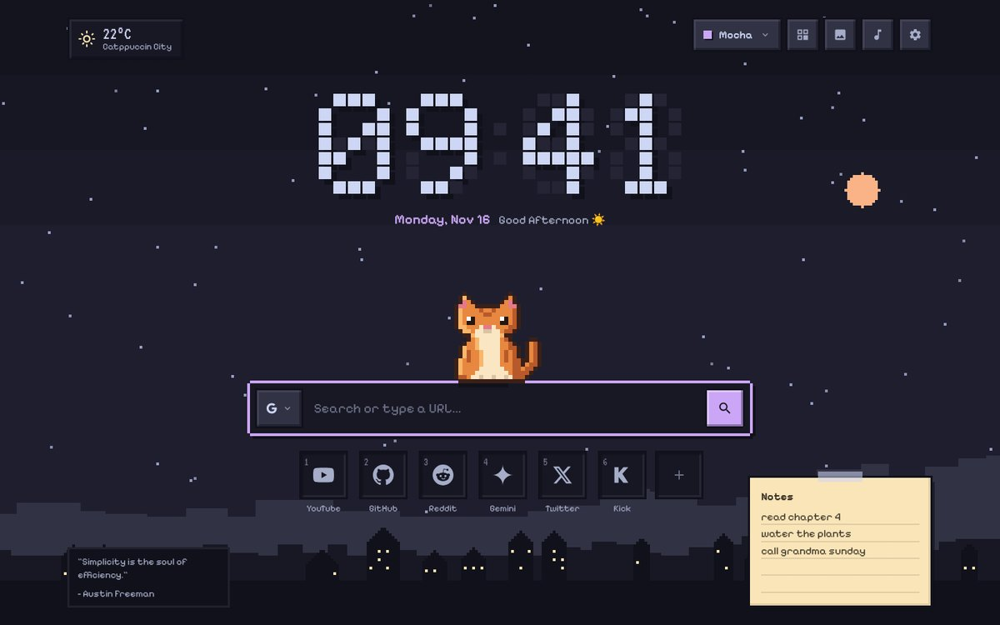
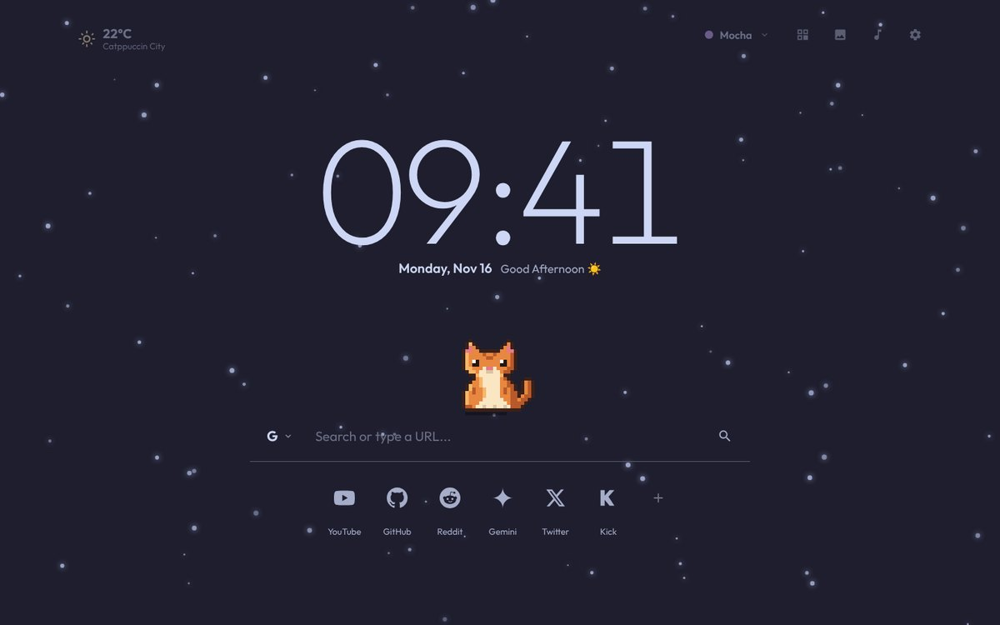
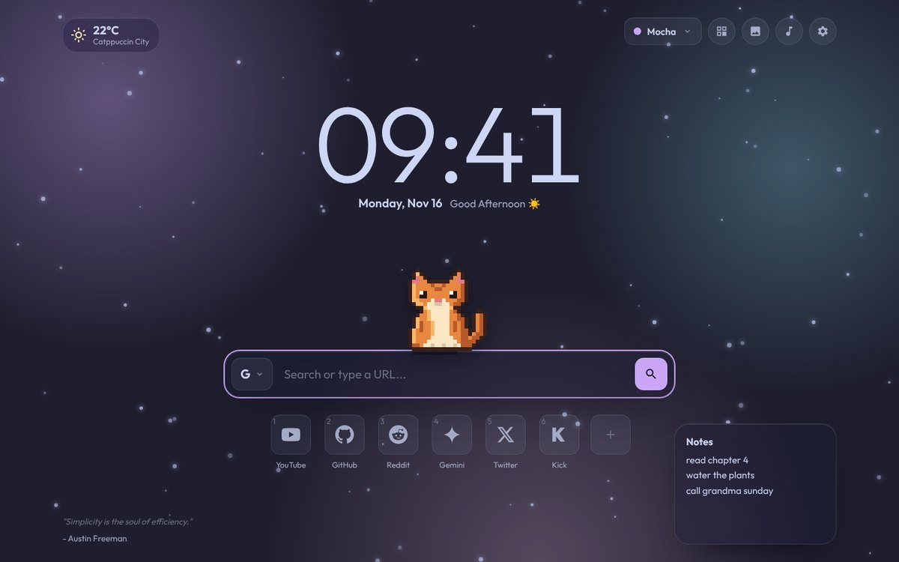
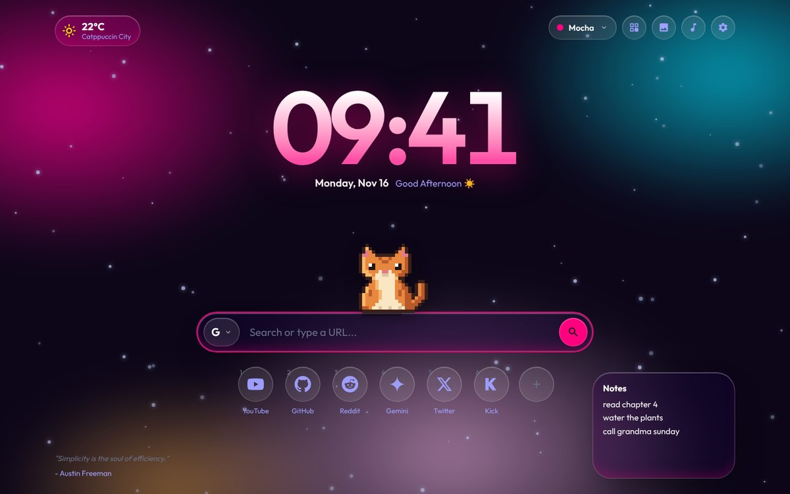
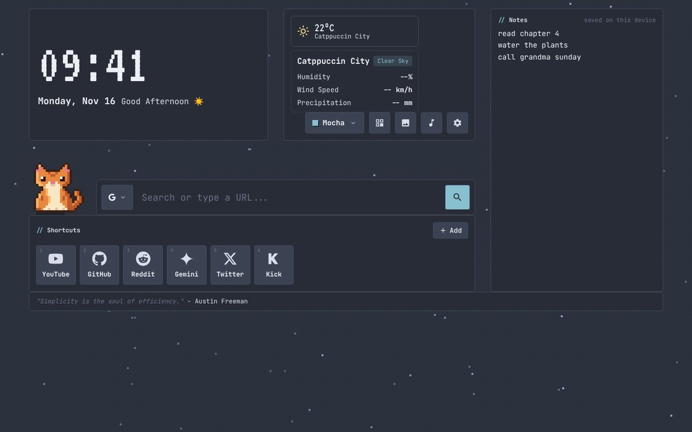
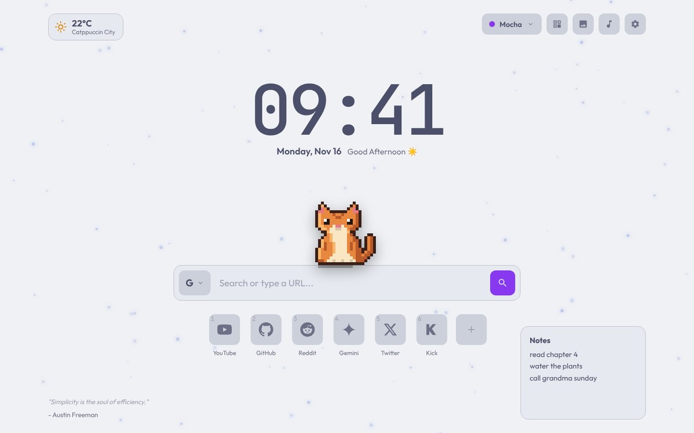
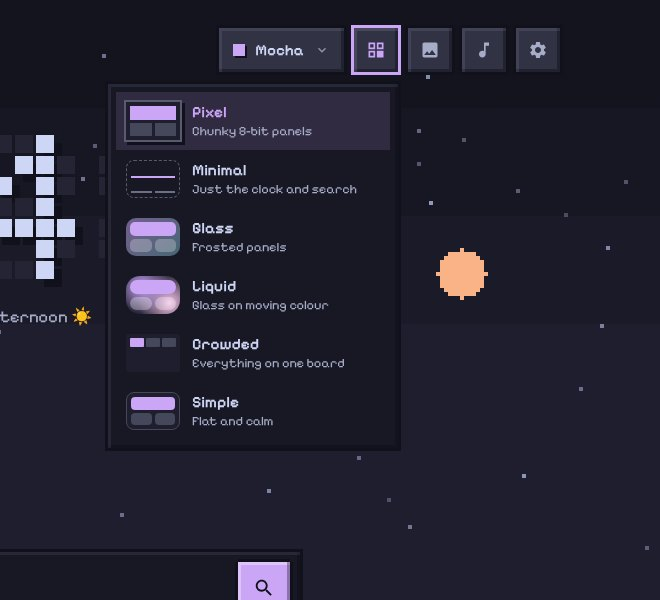
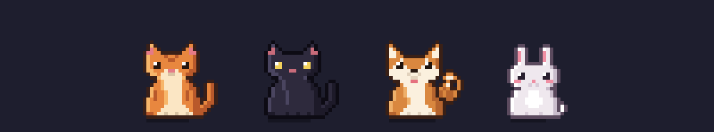
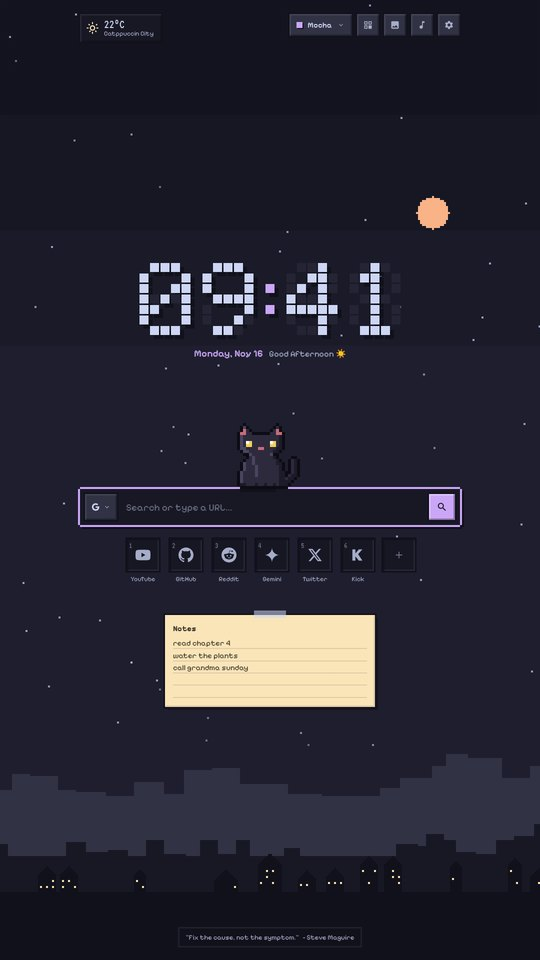

# Catppuccin New Tab

A pixel-art new tab page for Chrome and other Chromium browsers. It has a small animated pet sitting on your search bar, a desk of tiles around it, and two independent switches for the look:

- **Interface style:** how things are shaped.
- **Colour theme:** what colours they use.

Any style works with any theme.

## Interface styles

| Style | What it looks like |
|---|---|
| Pixel | An LCD clock, a night sky and a village on the horizon, inventory slots for shortcuts, and a sticky note. This is the default. |
| Minimal | Only the clock, the search bar and a quiet row of shortcuts. The tools fade out until you hover them. |
| Glass | Frosted panels over soft pools of colour. |
| Liquid | Glass with rounder shapes and colour that slowly drifts. |
| Crowded | Everything on one dense board, mono type, weather details always open. |
| Simple | Flat cards with thin borders, no blur and no shadows. |

| | |
|---|---|
|  Minimal |  Glass |
|  Liquid, Cyberpunk theme |  Crowded, Nord theme |
|  Simple, Latte theme |  The style menu |

To change the style, use the grid button next to the theme picker, or go to Settings → Interface Style.

## Colour themes

There are 16:

- Catppuccin: Mocha, Macchiato, Frappé, Latte
- Forest, Orange, Samurai Red, Sky Blue, Dark Blue
- Cyberpunk, Dracula, Nord, Sakura, Hot Pink, Toxic, Lavender

## Pets

There are four hand-drawn pets: a ginger cat, a black cat, a shiba and a bunny.

- They blink, breathe, flick their tails and twitch their ears.
- Leave the tab alone for a while and your pet falls asleep. Move the mouse or type and it wakes up.
- Click it and it hops.
- Drag it anywhere on the page and it stays there.
- Double-click it, or drop it back on the search bar, to send it home.

The old SVG Bongo Cat is still in the list, and you can pick none.

## Portrait screens

The layout is a single column, so it also works on a vertical monitor.

## Everything else

- Clock (12h or 24h, any timezone), date and greeting
- Weather for any city. It uses Open-Meteo, so no key is needed.
- Search across several engines
- Shortcuts in a hotbar:
  - keys 1 to 9 open them
  - drag to reorder them
  - edit or delete them on hover
  - choose rounded, square, circle or pill
- Notes, saved on this device
- Background image, video or YouTube link
- Star particles and ambient sounds

The fonts are bundled in `fonts/`, so the page doesn't need Google Fonts and looks the same offline. They are all SIL Open Font License; the licences are next to the font files.

## Install

1. Download or clone this repo.
2. Open `chrome://extensions` and turn on **Developer mode**.
3. Click **Load unpacked** and pick the repo folder.
4. Open a new tab.

## Files

| File | What it holds |
|---|---|
| `index.html` | The layout |
| `style.css` | The themes (`data-theme`) and the interface styles (`data-ui-style`) |
| `ui-style.js` | The style switcher. It loads in `<head>` so the page doesn't flash. |
| `pixel-pets.js` | The sprites and their animation |
| `pet-drag.js` | Moving the pet around |
| `desk.js` | The LCD clock, the pixel horizon and the number keys |
| `script.js` | Everything else: clock, weather, search, shortcuts, notes, settings and background |
